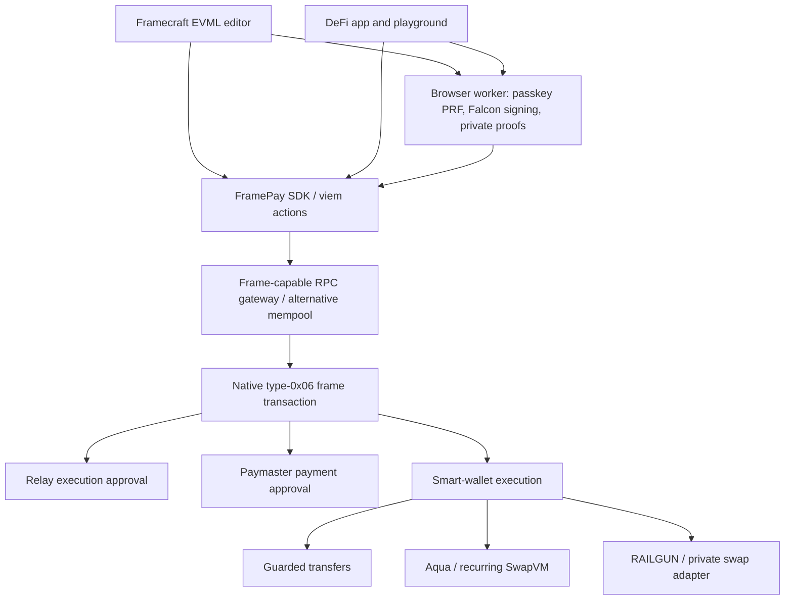

# Framecraft

**Build, authorize, and execute sponsored Ethereum frame transactions—with passkey-derived post-quantum wallets, programmable trading, and private payments.**

FramePay is an experimental TypeScript SDK, Solidity contract suite, and set of reference applications for **EIP-8141 frame transactions**. The web editor is branded **Framecraft**; the libraries and contracts use the FramePay name.

The project brings wallet authorization, gas sponsorship, and application execution into one transaction workflow. Users can create a smart wallet with a passkey, receive test tokens, transfer or swap assets without holding ETH for gas, and manage recurring buy positions. Developers can build these flows with the SDK or compose public and private operations in the browser using EVMcrispr's EVML scripting language.

**Status:** working devnet prototype using test assets and the `ethrex-eip8141-tracer` profile. Native frame execution requires a compatible gateway and execution client. This is not a mainnet deployment or an audited production wallet.

[Quickstart](#quickstart) · [Architecture](#architecture) · [SDK usage](#sdk-usage) · [Development commands](#development-commands) · [Documentation](#documentation)


## Architecture



## What the project does

Traditional transaction flows ask an account to sign individual calls and hold ETH to pay for execution. FramePay explores a workflow where authorization, payment approval, and application calls are explicit parts of a frame transaction. A funded paymaster can cover gas while a smart wallet enforces its own spending authorization.

The repository provides three ways to use this system:

| Entry point | What it offers | Local URL |
| --- | --- | --- |
| **Framecraft editor** | Write EVML, compose frame transactions, and mix public calls with private payments | `http://localhost:4321/editor` |
| **DeFi reference app** | Create a wallet, claim tokens, swap, transfer, manage positions and rules, and use private payments | `http://localhost:3000/app` |
| **SDK documentation and playground** | Explore APIs and prepare, sign, submit, and inspect frame transactions | `http://localhost:3000/docs/quickstart` and `http://localhost:3000/playground` |

### Passkey-derived post-quantum wallets

A PRF-capable passkey deterministically derives an **ETHFalcon** keypair in an isolated browser worker. The smart wallet's sole spending authority is its immutable Falcon public key. Each approved batch binds its calls, wallet, chain, genesis domain, nonce, and expiry to a Falcon signature verified onchain.

The passkey unlocks the key derivation; the quantum wallet does not verify a WebAuthn/P-256 signature onchain. A separate, replaceable SECP256K1 relay key signs the outer frame envelope and cannot independently spend the wallet's assets. Existing P-256 passkey wallets remain a separate legacy account type.

Only public quantum-wallet metadata is persisted or exported. Restoring access requires the original compatible passkey and its origin as well as that metadata. There is no administrator, recovery key, or upgrade path. See the [quantum wallet guide](docs/quantum-wallet.md).

### Sponsored transfers and swaps

The test paymaster approves gas payment subject to an immutable per-transaction cost ceiling. A user can hold zero ETH while claiming tokens, transferring ERC-20s, or trading through the sponsored app flows. Sponsorship covers gas; users still need the assets they transfer or trade.

Transfers use a guard for amount limits, expiry, and the recipient's actual token balance increase. The app also checks editable preferences such as recipient allowlists and required sponsorship before signing. Those browser preferences are not permanent smart-account permissions.

The sponsor is an **open test paymaster**: anyone can consume its funded budget within its limits. Token-fee reimbursement and production sponsorship policy are not implemented.

### Recurring buy positions with 1inch Aqua and SwapVM

A maker creates a partially fillable buy order with a fixed exchange rate, per-period spending allowance, lifetime budget, and expiry. Tokens remain in the maker's wallet, with an allowance and allocation through Aqua. Takers fill the order through a custom `FramePayRecurringSwapVM` that inherits the upstream SwapVM engine and enforces a mandatory recurring-buy instruction.

The public app uses **fpUSD** and **fpASSET**. Takers request an exact fpUSD output and cap the fpASSET input. Unused period capacity does not carry over, and makers can cancel positions to prevent further fills. Orders can be exported and imported as JSON.

Recurring positions make liquidity available on a schedule; **a taker must initiate every fill**. There is no automatic buying bot, market-price oracle, or guarantee that an order will be filled. See the [Aqua guide](docs/aqua-recurring-buy.md).

### Private payments and maker inventory

`@framepay/privacy` integrates RAILGUN notes, Groth16 proofs, and a two-leg private settlement adapter. It supports:

- Shielding public **FPA** and **FPB** test tokens into private pockets.
- Private transfers between owned pockets or to another user's `0zk…` receiving address.
- Moving notes into and out of maker-owned quoting inventory.
- Private swaps with both payment legs bound to the trade and settled atomically.
- Unshielding to a public address, with explicit net-of-fee amounts.

Browser proof generation and Falcon signing run in an isolated worker after passkey approval. A five-minute view-only session can refresh balances without repeated prompts and cannot spend. Shielding and unshielding each deduct the pool's **0.25% fee**.

The browser swap demonstration trades between pockets controlled by the same passkey. The CLI also demonstrates separate maker and taker wallets. Maker inventory is not pooled AMM liquidity, and the browser does not implement an external order book or independent-party proof exchange. See the [private payments guide](docs/private-payments.md).

### Scriptable transactions with EVML

The Astro app hosts EVMcrispr's editor with local `frame` and `privacy` integrations. Scripts can combine public contract calls, shield deposits, private transfers, swaps, and withdrawals in a single `frame:tx` envelope.

A `batch` inside `frame:tx` groups frames for atomic execution. Each private payment needs its own already-confirmed input note; newly created notes cannot be spent again in the same transaction. Dynamic pocket names derive accounts under the user's own passkey, while a full `0zk…` address identifies an external private recipient.

The editor prepares the complete plan, requests approval, generates proofs and wallet signatures, and submits the materialized envelope once to the alternative mempool. See [EVML commands and examples](apps/web/README.md#private-evml-scripts).

A typical sponsored quantum-wallet operation follows this path:

1. **Prepare and review:** choose the operation, amounts, recipient, limits, expiry, and gas payer.
2. **Authorize:** request passkey PRF, regenerate the Falcon key, and sign the exact wallet batch. Private actions also generate their proofs in the worker.
3. **Submit:** the relay signs an envelope containing execution approval, paymaster payment approval, and a SENDER frame calling the wallet.
4. **Execute:** the wallet verifies Falcon authorization and runs its calls; application contracts enforce transfer, trading, or proof constraints.
5. **Inspect:** check inclusion and every frame receipt. Save ambiguous transaction hashes and resolve their status before another submission.

**Atomicity has a scope.** Calls inside one wallet batch revert together, and the private swap adapter reverts both payment legs on failure. Independent frames are not automatically one atomic application operation: an approval in an earlier frame can remain after a later frame fails. In EVML, use `batch` within `frame:tx` when the grouped frames must succeed or revert together. Multiple transaction blocks are separate transactions.

## Quickstart

Run all commands below from the repository root containing `package.json`.

### Prerequisites

| Tool | Requirement |
| --- | --- |
| Node.js | **24**, as pinned in `.nvmrc`; Node runs the tooling even though Bun manages dependencies |
| Bun | **1.3.6**, as pinned in `.bun-version` and `packageManager` |
| Git | Required to fetch pinned upstream sources and the EVMcrispr editor |
| Emscripten | **3.1.74**, with `emcc` on `PATH`, to build the browser Falcon signer |
| Foundry | **v1.5.0** for Solidity builds, contract tests, and deployment tooling |
| Browser | A PRF-capable passkey authenticator on localhost or HTTPS for quantum-wallet flows |

The core Foundry project pins Solidity **0.8.33**; Aqua and private contract tooling use **0.8.30**. Initial setup needs network access for dependencies, source archives, circuit artifacts, and compilers. Using already deployed contracts in the browser does not require running Foundry locally.

### Install and prepare browser assets

```sh
nvm install
nvm use
bun install --frozen-lockfile

# Fetch the pinned ETHFalcon source.
bun run quantum:bootstrap

# Install/activate Emscripten 3.1.74 first; emcc must be available.
FRAMEPAY_EMCC=emcc bun run quantum:build
```

See the [signer build details](docs/quantum-wallet.md#reproduce). The generated signer is required by the editor's asset preparation and by quantum-wallet operations. Browser dev/build scripts generate the privacy worker and download and verify missing circuit artifacts. The editor also fetches and builds its pinned EVMcrispr dependency on first launch.

### Start an application

```sh
# Framecraft editor: http://localhost:4321/editor
bun run dev
```

Or, in another terminal:

```sh
# DeFi app: http://localhost:3000/app
bun run poc:dev
```

Choose **Framecraft devnet** for the configured hosted test environment. Its availability and funded test contracts are prerequisites for transactions; starting either app does not start a blockchain. A normal Anvil node cannot execute the native frame envelope.

### Try the DeFi flow

1. Create a quantum wallet using a PRF-capable passkey, then deploy the wallet.
2. Use **Get test tokens** to claim fpUSD and fpASSET.
3. Review and confirm a sponsored swap or token transfer.
4. Create a recurring buy under **Positions**, then export its order for another account to import and fill.
5. Adjust **Rules** to try transfer caps and sponsorship requirements.
6. Open **Privacy**, claim FPA and FPB, shield tokens, and wait for confirmation before transferring or swapping private notes.
7. Use **View transaction** to inspect the receipt, frames, gas, and available admission history.

The optional disposable test-account flow supports public app operations without a PRF-capable passkey. It stores a test private key in the tab's `sessionStorage` and does not provide Falcon authorization. Private browser operations require the passkey wallet.

Use the same app origin when restoring a passkey wallet. In particular, moving between `localhost`, `127.0.0.1`, and a hosted domain can change passkey availability. Export public metadata and retain the compatible credential; metadata alone cannot restore spending access.

## Networks and deployment

Named environments are defined in [`packages/sdk/src/networks.ts`](packages/sdk/src/networks.ts):

| Environment | Configured RPC |
| --- | --- |
| Framecraft devnet | `https://psi-essential-rebate-wrist.trycloudflare.com/rpc` |
| Local devnet | `http://127.0.0.1:14337/rpc` |
| Public alt-mempool devnet | `https://altmempoolgateway.forshtat.com/rpc` |

All three use **chain ID 1337**. They are separate environments, and contract deployments are not interchangeable. The app validates configured genesis and code hashes; chain ID alone is insufficient. The URLs above are repository configuration, not an uptime guarantee.

Deployment records live in [`config/paymasters.json`](config/paymasters.json), [`config/defi.json`](config/defi.json), [`config/quantum.json`](config/quantum.json), and [`config/private-wallet.json`](config/private-wallet.json). Source revisions and fingerprints are pinned in the corresponding configuration files.

Using the recorded deployments requires no redeployment. To provision contracts on a compatible devnet, follow the [DeFi setup](docs/defi-app.md#devnet-setup), [Aqua deployment guide](docs/aqua-recurring-buy.md), and [private setup guide](docs/private-payments.md#setup-and-run). Deployment and demo commands broadcast transactions and use test funding; setup commands only prepare dependencies and artifacts.

Local workshop configuration and revision pins are in [`config/local-devnet.json`](config/local-devnet.json) and [`config/devnet-lock.json`](config/devnet-lock.json). The default workshop path is `../mempool-workshop`, relative to this repository. That checkout and its gateway are provisioned separately.

## SDK usage

`@framepay/sdk` extends viem with frame-specific preparation, signing, submission, receipt, and admission actions. It is a private workspace package in this repository, not a published npm release.

This example creates a client and prepares an EOA ETH transfer for review; it does not sign or broadcast:

```ts
import { defineChain, http, parseEther, type Address } from 'viem';
import { createFrameClient, frameNetworks } from '@framepay/sdk';

const network = frameNetworks.devnet;
const chain = defineChain({
  id: network.chainId,
  name: network.name,
  nativeCurrency: { name: 'Test Ether', symbol: 'ETH', decimals: 18 },
  rpcUrls: { default: { http: [network.rpcUrl] } },
});

const client = createFrameClient({
  chain,
  transport: http(network.rpcUrl, { retryCount: 0 }),
  profile: network.profile,
});

export async function prepareTransfer(sender: Address, recipient: Address) {
  return client.prepareTransfer({
    sender,
    transfer: { to: recipient, value: parseEther('0.000000001') },
    payment: { type: 'self' },
    rules: {
      allowedRecipients: [recipient],
      maxValue: parseEther('0.001'),
      maxFeePerGas: 2_000_000_000n,
    },
    maxFeePerGas: 2_000_000_000n,
  });
}
```

After approval, use `signFrameTransaction`, `sendFrameTransaction`, and `waitForFrameReceipt`. The receipt helper rejects failed frames and can validate the expected frame count. `getFrameAdmission` reads the sidecar's admission record when available. The SDK disables transparent RPC retries and preserves the expected hash in submission errors so callers can inspect ambiguous outcomes.

`prepareTransfer` supports plain EOA-to-EOA ETH transfers. Use `prepareFrameTransaction` and explicit frames for contract accounts, tokens, and application calls. `privateKeyToFrameSigner` is a local SECP256K1 adapter; quantum-wallet helpers provide the separate Falcon authorization path. Gas limits are explicit; the SDK does not expose automatic frame gas estimation or a simulation action.

Build-checked examples: [extend viem](examples/extend-viem.ts), [compose a transfer](examples/compose-transfer.ts), and [sign, submit, and inspect frames](examples/frame-transfer.ts). The [privacy guide](docs/private-payments.md#using-effect) shows the injectable `PrivateProver`, `PrivateRpc`, and `PrivateSubmitter` Effect services.

## Repository layout

```text
.
├── apps/
│   ├── web/                 # Astro + React Framecraft EVML editor
│   └── poc/                 # Next.js DeFi app, SDK docs, and playground
├── packages/
│   ├── sdk/                 # viem actions, transfer plans, wallet helpers
│   └── privacy/             # RAILGUN proofs, notes, settlement, Effect services
├── contracts/
│   ├── src/                 # Paymaster and private settlement interfaces/guards
│   ├── test/                # Core Solidity tests
│   ├── aqua/                # Recurring SwapVM, transfer guard, wallet contracts
│   └── private/             # Private SwapVM, faucet, and real-proof tests
├── config/                  # Network identities, deployment records, source pins
├── docs/                    # Feature, setup, and verification guides
├── examples/                # Type-checked SDK usage
├── scripts/                 # Bootstrap, browser workers, deployment, demos, checks
├── tests/                   # SDK, app policy, privacy, and integration tests
├── brand/                   # Branding assets
├── .github/workflows/       # Build and test CI
├── bun.lock                 # Shared workspace lockfile
├── lerna.json               # Workspace task orchestration
└── nx.json                  # Build ordering; task-result caching disabled
```

Bun installs and links **five workspaces**: the two applications, SDK, privacy library, and core contracts. Lerna/Nx orders their builds. Aqua and private Foundry projects have separate scripts and compiler settings. Generated dependencies, browser assets, build output, runtime keys, and run reports are ignored by Git.

## Development commands

### Applications and builds

| Command | Purpose |
| --- | --- |
| `bun run dev` | Prepare assets and start the Astro editor |
| `bun run poc:dev` | Build browser dependencies and start the Next.js app |
| `bun run build` | Build all five workspaces and type-check examples |
| `bun run web:build` | Prepare assets, type-check, and build the Astro site |
| `bun run poc:build` | Build the Next.js app and workspace dependencies |
| `bun run sdk:build` | Build the SDK |
| `bun run privacy:build` | Build the SDK and privacy package |
| `bun run contracts:build` | Compile the core Foundry project |
| `bun run web:typecheck` / `bun run poc:typecheck` | Check application types |
| `bun run check:push` | Run the full build gate without Nx task-result caching |

### Tests and integration checks

## Deploy the Astro app to Vercel

Import this repository with **Root Directory `.`** and **Node.js 24.x**. The root
[`vercel.json`](vercel.json) pins Bun 1.3.6, builds only the Astro application and
its web dependencies, and publishes `apps/web/dist`. No environment variables,
Foundry installation, or Emscripten toolchain are required for this deployment.

The web build verifies the checked-in public Falcon signer and prepares the
privacy workers, circuit files, and Monaco assets. First builds need network
access for pinned upstream dependencies. See the [Vercel deployment guide](docs/vercel.md)
for exact settings, local verification, RPC requirements, and passkey origins.

## Git checks

Browser checks need their documented browser/Playwright prerequisites. Live demos such as `bun run aqua:demo` and `bun run private:demo` require a compatible running gateway, test funds, and the feature-specific setup. Use `FRAMEPAY_PRIVATE_RPC` to explicitly select a remote HTTPS gateway for the private CLI; its default is local.

### Git hooks and CI

`bun install` activates Husky. Pre-commit checks staged whitespace; pre-push runs `bun run check:push`. Use Bun for dependency changes and commit `bun.lock` rather than introducing another package-manager lockfile.

The [CI workflow](.github/workflows/ci.yml) installs frozen dependencies, runs `private:setup`, builds the workspaces, and runs core, privacy, and real-proof tests on pull requests and pushes to `main`. **The current workflow does not provision Emscripten or run `quantum:build`, although the web build requires the generated signer.** A fresh CI checkout needs that preparation added before the full build can succeed. Local full builds have the same prerequisite.

## Current limits

- **Experimental execution profile:** only `ethrex-eip8141-tracer` is supported. Workshop extensions and admission rules should not be treated as portable Ethereum guarantees.
- **Cryptographic scope:** ETHFalcon protects wallet spending authorization. The outer relay and RAILGUN's Groth16/EdDSA layer still use classical cryptography. Upstream ETHFalcon is unaudited and uses a Keccak variant, not the SHAKE-based NIST Falcon variant.
- **Privacy scope:** public deposits, withdrawals, submitting smart-wallet addresses, timing, and transaction shapes remain observable. Post-quantum authorization does not encrypt pending transactions.
- **Note selection:** the current privacy circuit uses one input and two outputs. Fragmented balances cannot be combined in one payment, and inputs must already be confirmed. The local index supports one 65,536-note tree and rejects rollover.
- **Browser recovery:** passkey compatibility and origin matter. Public metadata exports contain no spending key, and JavaScript cannot guarantee erasure of every runtime or hardware copy of secret material.
- **Prototype infrastructure:** test faucets and sponsors have finite balances. The configured gateway admits at most 16 frames, including verification/payment frames. Pending submissions must be inspected rather than blindly retried.
- **Future work:** production sponsorship, token-fee reimbursement, injected-wallet frame signing, independent-party browser swap coordination, persistent reorg-aware private indexing, and security audits remain outside the current implementation.

## Documentation

| Guide | Contents |
| --- | --- |
| [DeFi app](docs/defi-app.md) | User flows, assertions, deployment, persistence, and receipt inspection |
| [Quantum wallet](docs/quantum-wallet.md) | ETHFalcon authorization, passkey PRF, source builds, and recovery boundaries |
| [Private payments](docs/private-payments.md) | Browser privacy controls, CLI setup, Effect services, and proof tests |
| [Recurring buys](docs/aqua-recurring-buy.md) | Aqua/SwapVM design, order accounting, deployment, and demo resumption |
| [Framecraft editor](apps/web/README.md) | EVML syntax, private pockets, batched transactions, and browser assets |
| [Legacy passkey wallet](docs/passkey-wallet.md) | The separate P-256 account implementation |

Generated execution reports remain under ignored `.framepay/` directories. The feature guides describe prior verification runs and reproduction commands; those records are not a substitute for rerunning the relevant checks on a changed build or network.
