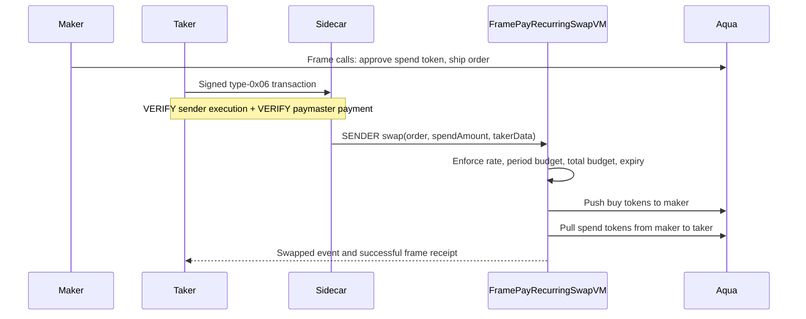

# Recurring buys with Aqua, SwapVM and frame transactions

FramePay implements a recurring, partially fillable limit-buy position using **official Aqua settlement and the official SwapVM execution engine**. `FramePayRecurringSwapVM` inherits `SwapVM` and adds a mandatory `RecurringBuy` instruction (`0xe0`). It is an application-specific SwapVM deployment, not a mock DEX.

The maker keeps the spend token in their wallet, approves Aqua, and ships an immutable order to Aqua. A taker supplies the asset the maker wants to buy and receives the spend token. The order enforces a per-period spending limit, lifetime budget, exchange rate and expiry. A taker must initiate each fill; this is not a scheduler or a guarantee of market liquidity.

## Run the local demo

Prerequisites: Node 20.12+, Foundry, and the existing frame-capable local ethrex/sidecar devnet. An ordinary Anvil fork does not implement EIP-8141. The local gateway must have a connected miner or automatic bundling. The scripts use `http://127.0.0.1:14337/rpc`, chain 1337, and the recorded local genesis.

```sh
npm run aqua:bootstrap
npm run aqua:test
npm run aqua:build

# Only needed if config/paymasters.json has no deployment for the current local genesis.
npm run paymaster:deploy -- --network local

npm run aqua:demo
```

`aqua:bootstrap` downloads the pinned SwapVM revision and exact Aqua, solidity-utils, OpenZeppelin and solc versions. Solidity source-tree fingerprints are checked before tests, builds and the demo. The compiler is solc 0.8.30 with Prague, viaIR and 600 optimizer runs. Existing paymaster compilation remains separate at 0.8.33. Dependency checkouts and generated Aqua artifacts are ignored by Git; a fresh checkout needs bootstrap and build.

The demo creates disposable maker and taker accounts, requests faucet ETH only for the maker, and deploys fixed-supply test tokens. Its parameters are:

| Parameter | Demo value |
| --- | --- |
| Spend token | fpUSD, 6 decimals |
| Buy token | fpASSET, 18 decimals |
| Period | 60 seconds, anchored to the position start |
| Period budget | 10 fpUSD |
| Total budget | 25 fpUSD |
| Price | 10 fpUSD per 1 fpASSET |
| Expiry | One hour after start |
| Carryover | None |
| Fills | 6 + 4 fpUSD in one period, 10 in the next, 5 in a later period |
| Taker ETH | Zero throughout the swaps |
| Gas payer | Recorded local FramePay test paymaster |

It waits for real local block timestamps between periods. No timestamp overrides, balance injection or replacement protocol contracts are used for the live demo. The Foundry tests separately use time manipulation to cover boundaries and failure cases.

The script checks each frame receipt, transaction type `0x06`, official `Swapped` events, recurring-buy accounting events, both parties' ERC-20 balance changes, total spending, and the taker's zero ETH balance. Read-only `eth_call` probes check that further fills fail when the period or total budget is exhausted. These probes are distinguished from the mined successful fills in the evidence.

## Transaction paths



Approvals, position shipping and swap fills use the standard alternative mempool through `eth_sendFrameTransaction`. Gas budgets are explicit; there is no automatic estimation. The test fee cap is 0.002 gwei, permitting the gas budgets within the paymaster's 0.001 ETH maximum exposure.

The large SwapVM router is deployed differently: an ordinary factory deployment is followed by a **canonical type-0x06 CREATE2 frame**, sent through the gateway's `eth_sendRawTransaction`. Its 40M state-gas allowance exceeds the standard sidecar's 25M total admission limit. Separating execution and state gas also avoids the legacy deployment's 16,777,216-gas execution limit on this devnet. This deployment may be absent from the sidecar explorer. Aqua and the test tokens use ordinary deployment transactions. The swap fills themselves use the standard alternative mempool and appear in its history.

## Contract behavior

`buildOrder(maker, spendToken, policy)` produces an official SwapVM order using `MakerTraitsLib`. The maker ships `abi.encode(order)` to Aqua with allocations for both tokens: initially zero for the asset being bought and the lifetime budget for the spend token. The order hash binds the maker, token pair, price, schedule, budgets and salt.

`buildTakerData(buyToken, spendToken, maxInput, deadline)` uses `TakerTraitsLib`. This router accepts **exact-output** fills: the taker requests a precise amount of the maker's spend token and caps the buy tokens they will pay. Partial fills mean several smaller calls against the standing order; an over-capacity request reverts instead of being silently truncated.

The maker receives `ceil(spendAmount × buyUnits / spendUnits)` raw buy-token units. Both rate components are raw units, so callers must account for token decimals. This is a fixed limit price, with no oracle or market-price discovery.

Every fill passes the recurring instruction. The program must contain exactly this one instruction; arbitrary trailing opcodes cannot alter the computed amounts after accounting. State is keyed by order hash. Period capacity resets at `start + n × period`; unused capacity never accumulates. Lifetime spending never resets, even if someone tops up Aqua's allocation. Aqua `dock` cancels the position; a new position needs a new salt and authorization.

Accounting is updated before settlement and rolls back if a token transfer or taker price check fails. The inherited SwapVM per-order reentrancy guard protects settlement. Production use would additionally require review of supported token behavior, liquidity availability and sponsorship policy. The demonstration uses conventional fixed-supply ERC-20s, EOA signatures and an open test sponsor; it does not implement PQ authorization, fee-on-transfer tokens or automatic recurring execution.

## Evidence and resuming

`evidence/aqua/local-*.json` contains public addresses, source fingerprints, transaction hashes, receipts, events and balance observations. Private keys remain in ignored `.framepay/aqua/*.key` files with restrictive permissions.

The runner journals each expected transaction hash before a single broadcast. Re-running `npm run aqua:demo` resumes by inspecting saved hashes. It does not blindly resend an uncertain transaction, change nonces, replace keys or redeploy completed steps. A verified run prints its existing result. A changed genesis, changed contract artifacts or expired unfinished position stops the run for review. Preserve the journal and evidence before deliberately starting a separate demo.

For a new independent demo (new accounts, deployments and position), choose a new name:

```sh
npm run aqua:demo -- --run finals-2
```

The new journal and keys live under `.framepay/aqua/runs/finals-2/`; the previous run remains intact. Reuse that name to resume it.

For an individual fill:

```sh
npm run transaction:inspect -- local 0x<fill-hash>
```

The local explorer URL is `http://localhost:5173/tx/<fill-hash>`. Explorer admission history is temporary; the receipt and token-transfer logs are the durable on-chain evidence. Paymaster balance observations can include concurrent use of the open sponsor, so the evidence does not attribute its entire balance decrease exclusively to these swaps.

## Verified local run

The [recorded run](../evidence/aqua/local-1793961624863.json) completed on November 6, 2026:

| Contract | Address |
| --- | --- |
| Official Aqua | `0x65a187Ba645d089E18581BA3b9F3F18F06ad6B3f` |
| FramePayRecurringSwapVM | `0x67d2F5b370F952305A2688e0AB79bD61796D105A` |
| fpUSD | `0xE7Fc49e7F3814d660AC95a8C3773F1c3D21a78f5` |
| fpASSET | `0x123Db5b7b3e3ceE236D2CB68a0011ed24C9e2E1A` |

| Fill | Period | Block | Explorer |
| --- | --- | --- | --- |
| 6 fpUSD → 0.6 fpASSET | 0 | 2389 | [Transaction](http://localhost:5173/tx/0x89a2b64f2453128bfe60d378ba7922ab0a7f83ef8a355a4cdeb3f103bd98936a) |
| 4 fpUSD → 0.4 fpASSET | 0 | 2390 | [Transaction](http://localhost:5173/tx/0x05b37fb2c1d550a72131ac279f4d38035c812c543b3ec19fac6a655610df6072) |
| 10 fpUSD → 1 fpASSET | 1 | 2399 | [Transaction](http://localhost:5173/tx/0xddddda3cff8bde9839df55d90083429f9061dc8a477ed4bbe5727f20ac30e53d) |
| 5 fpUSD → 0.5 fpASSET | 2 | 2409 | [Transaction](http://localhost:5173/tx/0x9d961b4d46fa5756ebf4ec535e02e3bf3721e8676ebf93c6352e2d24e382c848) |

The arrows describe the maker's exchange. The taker supplied 2.5 fpASSET and received 25 fpUSD. Every fill has three successful frame receipts; the taker held zero ETH before and after. Period and total exhaustion probes both returned `CapacityExceeded`. These addresses and links belong to the recorded local genesis and become historical if that chain resets.

## Official sources

- [SwapVM](https://github.com/1inch/swap-vm/tree/f9f4acfed0ffa321c2108efe05ecf7a5e0bd8abc): inherited execution, order hashing, taker checks, reentrancy protection and settlement.
- [Aqua](https://github.com/1inch/aqua): official npm release `@1inch/aqua@1.0.2-rc.2`, deployed without source changes.
- Exact Solidity source-tree fingerprints and dependency versions are in `config/aqua-sources.json`. Upstream license files remain in the downloaded packages and checkout; FramePay does not rewrite their source or license headers.

This demo provides a custom Aqua/SwapVM position, executable contract tests and real local ERC-20 settlement through frame transactions—the technical evidence described in the supplied prize requirements. Final prize eligibility remains the judges' decision.
