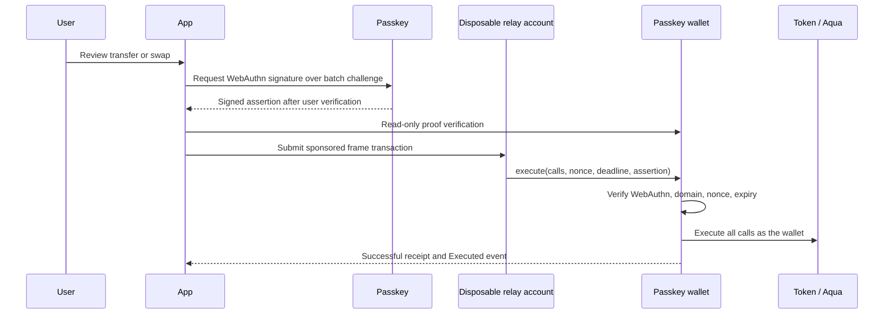

# Legacy P-256 passkey wallet

New accounts use the separate [ETHFalcon quantum wallet](quantum-wallet.md). This page documents existing P-256 wallets and their previously recorded demo; it does not describe the new wallet’s authorization.

The DeFi app can create a contract wallet controlled by a WebAuthn ES256 passkey. The wallet verifies the signature onchain before executing token transfers, swaps or recurring-position operations. The local devnet's native P-256 precompile at `0x100` was verified with a known valid signature; OpenZeppelin's verifier also supports a Solidity fallback.

## Use it

1. Open **http://localhost:3000/app** in a current passkey-capable browser. Use `localhost`, not `127.0.0.1`; passkeys are bound to a site. HTTPS is required outside localhost.
2. Select **Create passkey wallet** and approve your device or passkey provider's prompt. If you already use a test account, the same action is available in the account card and creates a separate wallet.
3. Select **Deploy wallet**, review the address and gas payer, and confirm. The paymaster sponsors a local frame transaction that creates the wallet.
4. Select **Get test tokens**. Confirm the review, then approve the passkey prompt. Tokens are claimed by the contract wallet.
5. Swap, transfer, or create a recurring position. Each review requests a new passkey approval bound to that particular batch.

**Export wallet metadata** saves the public key, credential ID, wallet address and deployment information. **Import wallet / test account** restores this metadata; the matching original or synced passkey is still required. Metadata alone cannot spend funds. This prototype uses one immutable passkey and has no recovery, credential rotation, upgrade administrator or attestation policy. Test assets only; losing access to the passkey means losing control of its wallet.

## Authorization and execution



The wallet holds the assets. A disposable SECP256K1 account submits the outer type-`0x06` envelope, and the existing paymaster pays gas. The relay key has no permission to spend wallet assets and can be replaced. Passkey verification happens inside the wallet's execution call; this version does not use a passkey as the frame envelope's native `VERIFY` authorization.

The challenge binds the protocol version, chain ID, wallet address, recorded genesis domain, sequential wallet nonce, deadline and complete ordered call list (target, value, calldata). The contract verifies:

- WebAuthn type and exact challenge.
- P-256 signature against the wallet's immutable public key.
- User presence and user verification flags, including backup-flag consistency.
- Authenticator RP ID hash, signed origin and `crossOrigin:false`.
- Nonce and expiry before execution.

The SDK uses the authenticator's exact `clientDataJSON` bytes and strictly decodes DER signatures, normalizing high-S values for OpenZeppelin. It compares its locally calculated challenge with the contract's result before requesting a signature. It requires current browsers that supply compact WebAuthn client JSON with `crossOrigin:false` and support exporting the public key from registration.

All application calls in one wallet execution succeed together or revert together, including approvals and the wallet nonce. A reentrancy guard blocks nested execution. A relayer may submit an already-signed batch but cannot change its destination, value or calldata. Ordinary EOA test-account frames retain their existing separate-frame rollback behavior.

Passkey authentication is P-256, **not post-quantum authorization**. The separate quantum wallet uses ETHFalcon as its sole onchain spending authority. Authenticator attestation is not checked, so successful verification proves key possession and signed flags, not a particular hardware model.

## Setup and implementation

After the local DeFi app setup:

```sh
npm run aqua:build
npm run passkey:deploy
npm run web:dev
```

The deployer checks pinned OpenZeppelin 5.6.1 sources and build artifacts. It deploys `FramePayPasskeyFactory`, checks native P-256 support and writes `config/passkeys.json`. The browser verifies the factory code hash and genesis, predicts each CREATE2 wallet address from the credential, and checks its onchain public key and domain fields before use. Public devnet deployment is not configured.

- Wallet/factory: `contracts/aqua/src/FramePayPasskeyWallet.sol`.
- Reusable SDK registration, proof parsing, challenge and ABI helpers: `packages/sdk/src/passkey.ts`.
- App account, review and submission integration: `apps/web/src/components/defi/use-defi.ts`.
- Wallet tests: `contracts/aqua/test/PasskeyWallet.t.sol`; SDK tests: `tests/passkey.test.mjs`.

## Verification

The legacy wallet remains covered by the Solidity and SDK tests. New browser demos use the PRF-derived ETHFalcon wallet on FramePay devnet. Generated reports and screenshots are stored under ignored `.framepay/`; historical run dumps are not tracked.
