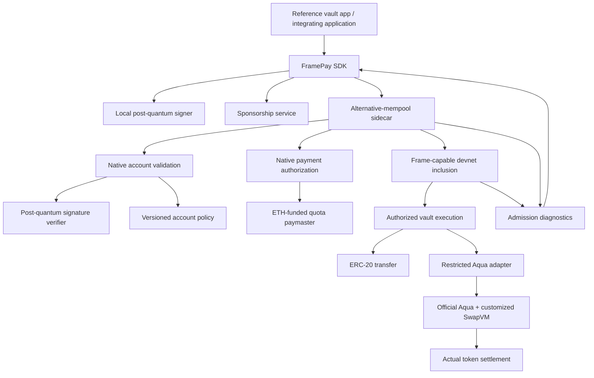

# FramePay SDK — implementation plan and build record

This document records how we intend to build the project, why we choose each component, the work remaining, and what has actually been completed. The product overview is in [README.md](README.md).

## Current status

**Milestone 1 is in progress, with the first viem SDK prototype implemented alongside it.** FramePay includes typed prepare/sign/submit/receipt/admission actions, a Next.js documentation site and local-devnet playground, source fingerprint checks, local environment inspection, and a baseline frame-transfer runner using the SDK. A separate local workshop devnet has been set up, and its handoff records an earlier successful transaction. Fresh live SDK evidence, runtime image identification, and official Aqua/SwapVM execution remain outstanding. PQ vault/paymaster contracts and the DeFi reference app are not implemented; the SDK package is private and unpublished.

## Build record

### November 6, 2026 — project definition and planning

**Completed:**

- Reviewed the saved ETHGlobal prize-page text for the 1inch Aqua and EF alternative-mempool requirements.
- Defined the project as a TypeScript SDK plus a reference DeFi app using a user's smart-account vault.
- Selected the initial scope: PQ authorization, application-funded gas sponsorship, ERC-20 transfers, and one custom Aqua/SwapVM position.
- Documented the proposed architecture, SDK interface, development milestones, validation cases, and demo flow.
- Separated the project description into `README.md` and the implementation plan/build record into `plan.md`.

**Decisions and rationale:**

| Decision | Reason |
| --- | --- |
| SDK plus a reference app | Give developers a reusable integration and demonstrate that it works end to end |
| App-funded sponsorship first | Prove a zero-ETH user flow before adding token-fee settlement complexity |
| ML-DSA as the initial signature candidate | Evaluate a standardized PQ signature scheme; final implementation and parameters depend on measured compatibility and cost |
| One recurring Aqua position | Provide meaningful SwapVM strategy logic and actual settlement for the 1inch integration |
| EF frame-capable environment | Exercise native account/payment authorization and real alternative-mempool submission |
| Defer sealed execution and decentralized decryption | Keep the first implementation focused while preserving them as follow-up work |

**Verification performed:** Documentation structure and source references were checked. No contracts, cryptographic verifiers, SDK code, deployment, or live transaction flow have been tested yet. Linked implementation documentation was unreachable during planning because network DNS resolution failed.

### November 6, 2026 — local devnet handoff reviewed

Reviewed [AGENT_HANDOFF.md](AGENT_HANDOFF.md), the sibling workshop's `AGENTS.md`, `README.md`, `LOCAL_DEVNET.md`, gateway configuration, and frame submission helpers.

**Existing setup evidence:** the workshop's safe progress fields list `step_1_check` and `step_2_tx_first` as completed. Its last transaction hash is `0x4d1c30fd3a09be09c50f77dff328c0ade930bede8e21f34db8badf7031df8da6`. The handoff reports faucet funding of 1 ETH and two successful frames mined in block 67. This is workshop infrastructure evidence, not a completed FramePay SDK feature.

**Verification in this review:** confirmed the local gateway/chain configuration and the distinct submission helpers for canonical and standard alt-mempool admission. A read-only connection attempt to the gateway failed from this agent session; current uptime and the live receipt were not independently verified. No workshop reset, new transaction, or infrastructure restart was performed, and no participant private key was printed.

Observed checkout base commits: workshop `bcfe02a`, sidecar `2e22ff0`. Local deployment additions and moving Docker image tags mean these commits alone do not pin the complete running environment; capture launcher changes and actual image digests with later reproducibility evidence.

**Next integration step:** resume with the existing paymaster example, then inspect its authorization/payment flow for the FramePay adapter. PQ verification and Aqua deployment are still unproven in this local environment.

### November 6, 2026 — milestone 1 tooling implemented

**Implemented:**

- Added Node-based development commands in `package.json`. They use the installed workshop codec through its public package exports; no sidecar build output is imported or copied.
- Added `config/local-devnet.json` for FramePay's local integration configuration and `config/devnet-lock.json` for the workshop/sidecar base commits, dependency versions, and 31 SHA-256 fingerprints of public source, lockfiles, codec files, and local deployment configuration. This is an observed-source lock, not proof that moving container images match those sources.
- Added `scripts/devnet/inspect.mjs` to verify source pins and collect gateway/client/sidecar information plus Docker image IDs/digests when accessible. Image collection projects only names and image identifiers, never container environments or funding keys.
- Added `scripts/devnet/smoke.mjs` to build and sign one baseline two-frame transfer, submit it once through `eth_sendFrameTransaction`, validate transaction type and per-frame receipts, and collect admission evidence. The hash is saved before submission. This baseline uses SECP256K1; it is not the later PQ vault or sponsored transfer.
- Added ten offline tests for chain/configuration restrictions, source fingerprints, malformed or failed receipts, pending/inclusion behavior, error redaction, RPC errors, admission evidence, and signature binding using the actual installed codec.
- Added ignored directories for private runtime locks, dependencies, and upstream checkouts. The scripts read the existing workshop participant in memory and never modify its state file or reset workshop progress.

**Results:** all ten offline tests passed. All 31 recorded source fingerprints matched. A live environment inspection and smoke attempt failed at gateway connectivity; the smoke report records `not-submitted`, and no transaction was broadcast. Docker socket access is denied in this agent session. Fetching official Aqua sources failed because GitHub DNS resolution was unavailable. These are execution-environment limitations, not evidence that the user's devnet is broken.

Evidence reports are in `evidence/milestone-1/`. Reports distinguish offline inspection, unsuccessful live attempts, prepared transactions, and verified execution; an offline pass does not prove devnet compatibility. No milestone is marked complete solely on the basis of fixtures or historical workshop progress.

### November 6, 2026 — first viem SDK prototype

**Direction:** prioritize the EF developer-tooling track with a reusable viem integration. Keep PQ accounts and the Aqua reference app as consumers of that SDK. Existing milestone 1 deployment checks remain open; adding offline SDK code does not complete them.

**Implemented:**

- Added the private `@framepay/sdk` TypeScript workspace with a viem `frameActions()` extension and a `createFrameClient()` convenience factory.
- Implemented `prepareFrameTransaction`, `signFrameTransaction`, `sendFrameTransaction`, `getFrameReceipt`, `waitForFrameReceipt`, and `getFrameAdmission` for the explicit `ethrex-eip8141-tracer` profile.
- Added a local SECP256K1 signer adapter for the workshop baseline, plus a signer interface for future account integrations. No PQ verification or browser-wallet frame-signing protocol is claimed.
- Required an explicit nonce sequence when nonzero nonce keys are supplied. Recent-root envelope references can be passed through; root freshness and keyed-nonce allocation helpers remain future work.
- Added staged errors that retain the expected transaction hash on ambiguous submission failures, suppress transport/signing payloads, disable automatic RPC retries, reject altered signer envelopes, and distinguish failed frames from inclusion timeouts.
- Added a development bootstrap that links the existing pinned workshop dependencies into ignored local `node_modules`; production SDK source contains no workshop-path or Node filesystem imports.
- Added two typechecked consumer examples and connected the devnet smoke runner to the SDK's public API.

**Verification:** TypeScript compilation and both consumer examples passed. All 22 tests passed: ten existing environment/codec tests and twelve SDK tests using the real viem transport wrapper and installed frame codec with mocked RPC responses. Tests cover the full API path, incorrect chains, explicit keyed nonces, signer mutation, immutable submission snapshots, no write retries, invalid/failed receipts, timeout/cancellation including stalled reads, missing admission history, and admission rule reporting. The live smoke was attempted again and stopped at gateway connectivity with `not-submitted`; no new transaction was sent.

### November 6, 2026 — SDK documentation and browser playground

**Implemented:**

- Added `apps/web`, a Next.js 16.3.1 App Router workspace with React 19.2.8 and TypeScript. The responsive interface includes an overview, quickstart, six API reference pages, keyboard-searchable navigation, syntax-highlighted examples, and copy controls.
- Added a playground that imports the actual `@framepay/sdk` package. It creates a disposable browser-memory signer, requests local faucet funding, and separates prepare, sign, and submit into explicit actions. The baseline sends a self-paid SECP256K1 transfer, capped at 0.001 test ETH per transaction; it does not demonstrate PQ authorization or sponsorship.
- Added live chain/block status, envelope inspection, per-frame receipts, admission reports, transaction-hash lookup, session activity, and public JSON exports. The interface preserves the expected hash after an ambiguous submission and offers receipt checks without automatic resubmission. Stopping receipt polling does not cancel a submitted transaction.
- Added a same-origin `/api/rpc` proxy to the fixed local gateway, avoiding browser CORS requirements. It restricts methods, checks request shapes and the submitted chain ID, limits streamed bodies to 64 KiB, rejects remote upstream configuration, and sanitizes gateway errors. It never reads the workshop participant key or state file. Browser-generated keys are neither persisted nor sent to the server.
- Used the installed frontend dependencies through an optional version-checked bootstrap because npm network access was unavailable. Webpack supports those external dependency symlinks. No sibling checkout was modified.

**Run from the FramePay directory:** dependencies are already linked in this workspace. With the existing local workshop devnet running on port 14337, run:

```sh
npm run web:dev
```

Open `http://127.0.0.1:3000` for docs or `/playground` to create and fund a disposable account, then prepare, sign, and submit. Reloading or leaving the playground discards its signer; use only disposable local test funds. Receipt/admission lookup also works without creating an account. The gateway must report chain 1337 and the local chain must have activated frame support.

For this offline workspace layout, dependencies can be linked again with:

```sh
npm run sdk:bootstrap
npm run web:bootstrap -- ../Stratigies/ethglobal_data_scracper/node_modules
```

The second argument is an existing dependency directory containing the exact versions declared in `apps/web/package.json`; it is only a development bootstrap, not a runtime dependency on that application. An ordinary workspace dependency installation is the intended alternative when registry access is available. The default gateway is `http://127.0.0.1:14337/rpc`; a different loopback HTTP endpoint can be set with the server-only `FRAMEPAY_RPC_URL` environment variable. Remote gateways are deliberately outside this local playground's current scope.

**Verification:** `npm test` passed all 29 tests, including seven new proxy tests for forwarding, method/chain restrictions, gateway restrictions, origin/body validation, streamed size limits, malformed upstream responses, and error redaction. `npm run web:typecheck` and `npm run web:build` passed. The production build generated the docs and playground routes. Generated HTML links and anchors were checked separately.

**Remaining verification:** this agent session cannot listen on port 3000, launch its browser check, or reach the local gateway. Rendered browser behavior and a live browser-submitted transaction therefore remain unverified. No screenshot or new successful devnet transaction is claimed. The next live check is to open the playground against the running workshop and inspect its actual receipt and admission report. Paymaster, PQ, Aqua, and simulation flows remain subsequent work.

### Recording implementation as it happens

Append a dated entry for each completed milestone. Include:

- What was implemented and which files or commits contain it.
- The selected dependencies, versions, network, and configuration relevant to reproduction.
- Why the approach was chosen and any change from this plan.
- Checks actually run, their outcomes, and links to traces, measurements, or transaction records.
- Remaining limitations and the next step.

Mark tasks complete only when their acceptance evidence exists. This record should describe the actual implementation as it develops, rather than presenting planned features as already built.

## Local development environment

The workshop checkout is `../mempool-workshop` relative to FramePay. Its sidecar checkout is nested at `../mempool-workshop/mempool-workshop-sidecar`. See [AGENT_HANDOFF.md](AGENT_HANDOFF.md) for detailed integration guidance and the workshop's `LOCAL_DEVNET.md` for infrastructure operations.

| Item | Current local configuration |
| --- | --- |
| Gateway RPC | `http://localhost:14337/rpc` |
| Explorer | `http://localhost:5173/` |
| Chain ID | `1337` (`0x539`) |
| Frame codec profile | `ethrex-eip8141-tracer`, transaction type `0x06` |
| Staking registry | `0xd51c04d7a0b01124e84de152f4e56d9eecb22d2f` |
| Entry-point sentinel | `0x00000000000000000000000000000000000000aa`; not a deployed ERC-4337 EntryPoint |
| Workshop configuration | `workshop.config.json5`; all keys required, no environment-variable overrides |

Application requests go through the gateway sidecar. Frame submissions gossip to the miner sidecar, which submits to ethrex. Lighthouse supplies consensus/block production. Gateway chain reads and raw transactions are forwarded to ethrex.

The sidecar implements the workshop's **standard alt-mempool**, based on `forshtat/ERCs` PR #6. Its rules are not identical to the later ERC-8421 specification. The **canonical mempool** is the frame client's own public admission path.

### Start or resume

With Docker Desktop running, execute from the workshop directory:

```sh
cd ../mempool-workshop
node mempool-workshop-sidecar/deploy/local/start.mjs
```

The documented launcher preserves existing data. On a newly initialized chain, genesis takes approximately five minutes and the local Hegota fork activates approximately eleven minutes after initialization. Frame transactions require that activation; a chain-ID response alone does not establish readiness. These timings refer to this local configuration, not an Ethereum mainnet upgrade schedule.

A read-only connectivity check:

```sh
curl -sS http://localhost:14337/rpc \
  -H 'content-type: application/json' \
  --data '{"jsonrpc":"2.0","id":1,"method":"eth_chainId","params":[]}'
```

Since workshop steps 1 and 2 are already recorded as complete, the next example is:

```sh
yarn step_3_tx_paymaster
```

Do not rerun `step_1_check` merely to check connectivity: it resets recorded addresses and completed steps. Keep `.workshop-state.json` and infrastructure runtime key files out of Git and logs. Use the local faucet rather than a public devnet genesis key.

### SDK integration references

- Use `@forshtat/hegota-support` and the workshop's frame helpers rather than implementing a new codec or importing sidecar build output.
- `sendFrameTx(tx)` submits `eth_sendFrameTransaction([toWire(tx)])` to the gateway's standard alt-mempool path.
- `sendRawFrameTx(tx)` submits encoded type-`0x06` bytes through `eth_sendRawTransaction`, forwarded to canonical admission.
- Read nonces from the chain and use the profile's execution/state gas fields. Sign again after changing an authorized envelope.
- `waitForReceipt(hash)` checks the transaction status and each returned frame status. Capture receipt evidence for FramePay tests.
- After rejection, inspect `yarn step_11_debug <txHash>` before changing the transaction or validation policy.

## Commit workflow

When the user uses a parenthesized tag as a work or commit instruction, complete the relevant work, perform appropriate verification, and create a local commit. A standalone tag applies to the relevant pending work from the conversation. Mentions of tags as examples or questions do not themselves request a commit. Normalize capitalization and surrounding whitespace.

| User tag | Commit type | Purpose |
| --- | --- | --- |
| `(doc)` or `(docs)` | `docs` | Documentation |
| `(feat)` | `feat` | A new capability |
| `(bug-fix)` or `(fix)` | `fix` | Correcting a defect |
| `(refactor)` | `refactor` | Restructuring without an intended behavior change |
| `(test)` | `test` | Tests and test fixtures |
| `(chore)` | `chore` | Repository maintenance |
| `(build)` | `build` | Build tooling and dependencies |
| `(ci)` | `ci` | Continuous integration |
| `(perf)` | `perf` | A measured performance improvement |

Use Conventional Commit subjects: `type(scope): concrete summary`. Choose a meaningful scope such as `sdk`, `account`, `paymaster`, `aqua`, or `plan`; omit it when it adds no information. Mark breaking changes explicitly when applicable.

Include a concise, factual audit trail in the message body:

```text
type(scope): concrete summary

Why:
- Problem or reason for the change.

Changes:
- What this commit implements.

Validation:
- Checks actually performed and their outcomes.
- Checks not run and the reason, where relevant.
```

Before committing, inspect the working tree and staged diff. Stage only the files or hunks relevant to the requested work; preserve unrelated edits and existing staged work. Split independent changes into coherent commits when needed. Update this plan's build record for meaningful implementation milestones, with actual evidence rather than claims of unperformed checks.

Create new commits rather than rewriting existing history unless the user requests otherwise. Do not create empty commits or fabricate test results. Commit creation does not authorize a push; push only when requested. After committing, report the commit hash, subject, verification outcome, and any relevant work left uncommitted. If a tool restriction prevents the commit, report it explicitly rather than claiming success.

## MVP scope

| Component | First version | Evidence of completion |
| --- | --- | --- |
| PQ vault | Native account validation using one selected post-quantum signature scheme | Valid authorization succeeds; modified signatures, actions, and replay fail |
| Sponsored transfer | Transfer one supported standard ERC-20 from a zero-ETH vault | Real recipient balance change and frame transaction record |
| Paymaster | App-funded sponsorship with application restrictions, expiry, quotas, and gas caps | Authorized request succeeds; unauthorized or exhausted request fails |
| Aqua integration | One real custom SwapVM position using official Aqua contracts | Successful token settlement plus enforced strategy limits |
| Atomic application actions | A supported group of actions with all-or-nothing application state changes | Deliberate failure proves the intended rollback boundary |
| SDK | Prepare, authorize, simulate, submit, and observe operations | Reference app uses the public SDK interface rather than custom submission code |
| Diagnostics | Distinguish authorization, sponsorship, admission, and execution outcomes | A developer can identify and reproduce a failed action |

Start with one chain, one token pair, one account type, and one sponsor. Use standard test tokens and funded test counterparties.

## Architecture



This diagram assigns responsibilities. It is not an exact frame layout or a claim that each validation step uses a separate frame. Use the supplied client's actual EIP-8141 transaction format, authorization rules, and failure semantics.

### Account and authorization

- Store or bind the owner's PQ public key using a representation supported by the chosen verifier.
- Authorize the complete intended operation, including chain/account domain, action data, replay protection, key/policy version, and bounded payment parameters as applicable to the actual frame format.
- Use the target client's canonical signing and encoding rules. Do not invent a transaction digest that omits security-relevant fields.
- Require equivalent authorization for key rotation and other security-critical account changes.
- Do not introduce an unrestricted ECDSA owner, recovery key, or upgrade administrator that bypasses PQ asset authorization.
- Constrain approvals and strategy permissions. An outstanding allowance can permit asset movements without a fresh vault signature, so it is part of the account's effective authority.

For the MVP, prefer a fixed account implementation and a minimal authorization surface. Recovery and upgradeability require a separate design before being offered as features.

### Post-quantum cryptography

**Initial candidate: ML-DSA.** Choose the parameter set only after measuring verification gas, calldata size, account setup cost, and support in the supplied environment.

Use an existing, independently reviewed implementation where available, and verify its provenance and compatibility. This project should integrate a signature scheme, not invent one. Validate the implementation with the scheme's known-answer vectors and malformed-input cases.

The first technical gate is an actual successful PQ verification in the frame-capable client. No PQ precompile or acceptable verification cost is assumed. If that gate fails, the PQ feature remains incomplete; do not substitute an ordinary signature and label it post-quantum.

The claim is limited to the implemented account authorization path. It does not make Ethereum consensus, counterparties, or every external contract quantum secure.

**PQ signatures do not encrypt transactions.** ML-KEM and sealed order flow are separate, deferred features.

### Paymaster

The MVP uses **application-funded gas sponsorship**. It does not charge a token fee to the user.

Public sponsorship parameters should bind the account, authorized operation, chain, expiry, and maximum gas exposure. The paymaster checks supported applications and external quota/policy state through the target client's supported validation mechanism.

Keep these separate:

- ETH held to pay network gas.
- Per-account or per-application sponsorship budgets.
- Any stake required for alternative-mempool admission.
- The user's trading balance.

Two pending operations may both appear eligible against the same old quota. Use appropriate reservations and authoritative accounting, and verify the actual client semantics. Prove the sponsor's exposure when application execution reverts; do not rely on application state that rolls back to preserve a fee reservation.

### Atomic execution

For this project, “atomic” means a documented group of **same-chain application actions** either completes or has its application state changes reverted. It does not mean cross-chain atomic settlement.

Implement the operation through a supported account/adapter execution path with a proven rollback boundary. Do not assume all frames automatically share one revert scope. Gas and native authorization/payment bookkeeping can behave differently from application state on failure.

## Reference Aqua application

Build a **recurring, partially fillable buy position** rather than a generic swap button.

Example: a vault offers up to 10 test-USDC per period to acquire a target asset, subject to a maximum purchase price, overall spending cap, and expiry. State explicitly whether unused period capacity carries over; the initial policy is no carryover.

The position uses:

- **Official Aqua contracts** for the supported liquidity and settlement path.
- **SwapVM strategy logic** for time, price, fill, and capacity restrictions.
- **A custom instruction or supported extension**, where needed, for the position's additional accounting. Its interface depends on inspection of the actual interpreter.
- **A restricted adapter** for SDK-driven vault interactions, if the official execution flow requires one.

The vault is the maker offering funds under its strategy. A funded taker supplies the desired asset and receives the offered asset. Publishing a recurring position does not guarantee it will be filled on schedule; the demo uses explicit test counterparties.

PQ-authorized frame operations create or manage the position using the actual supported contract flow. Taker fills must satisfy the position's enforced permissions and limits. Do not imply that every fill requires a fresh owner signature if the owner has already authorized a standing position.

Settlement must prevent two concurrent fills from exceeding the same remaining capacity. Enforce limits in the mandatory settlement path, not only in frontend checks, SDK simulation, or one optional caller's account validation.

## Implemented viem SDK prototype

Choose viem first because the workshop's installed codec already depends on it, its client extension mechanism supports custom actions, and ABI encoding and normal chain reads can stay in the application's existing client. An ethers adapter can follow after the shared operation lifecycle is verified.

The SDK adds a developer-facing lifecycle around `@forshtat/hegota-support`; it does not reimplement its RLP, signature hashing, or JSON-RPC wire encoding. The first version explicitly targets this workshop's profile and PR #6 admission implementation, rather than claiming compatibility with every revision of ERC-8421.

| Action | Current behavior |
| --- | --- |
| `prepareFrameTransaction` | Checks the live chain, accepts explicit frames/fees, and reads the ordinary account nonce when none is provided |
| `signFrameTransaction` | Delegates to a signer and rejects changes to the authorized envelope |
| `sendFrameTransaction` | Sends through `eth_sendFrameTransaction` with retries disabled and verifies the returned hash |
| `getFrameReceipt` | Reads and validates per-frame receipt structure; preserves success/failure statuses |
| `waitForFrameReceipt` | Waits for successful frame execution or returns a typed failure, timeout, or cancellation error |
| `getFrameAdmission` | Returns retained admission outcome and rule checks; missing history is distinct from rejection |

Use the exported extension on an existing viem client:

```ts
import { createPublicClient, defineChain, http } from 'viem';
import { frameActions } from '@framepay/sdk';

const gateway = 'http://localhost:14337/rpc';
const chain = defineChain({
  id: 1337,
  name: 'Local frame devnet',
  nativeCurrency: { name: 'Test Ether', symbol: 'ETH', decimals: 18 },
  rpcUrls: { default: { http: [gateway] } },
});

const client = createPublicClient({ chain, transport: http(gateway, { retryCount: 0 }) })
  .extend(frameActions({ profile: 'ethrex-eip8141-tracer' }));
```

The complete transfer flow is in `examples/frame-transfer.ts`; the minimal extension is in `examples/extend-viem.ts`. Importing either example does not submit a transaction. `@framepay/sdk` is currently a local workspace name, not a published npm package.

**Current limits:** gas limits are supplied explicitly, not estimated. Preparing a transaction is not an admission simulation. The nonce read is not a reservation; serialize ordinary-nonce sends and inspect unresolved submissions. Receipt waiting establishes observed inclusion, not finality. Canceling a wait does not cancel the transaction or guarantee cancellation of an in-flight read. An explorer RPC error remains an error; only an explicitly absent retained record is reported as unavailable. Use an appropriate timeout on the viem transport as well.

**SDK implementation sequence:**

1. Complete the live prepare/sign/submit/receipt/admission demonstration through the existing gateway.
2. Inspect and implement the actual supported admission-simulation RPC, with clear separation between simulation and execution. Do not substitute a generic `eth_call` for frame validation.
3. Add account/paymaster adapters and an application-funded sponsored transfer using the workshop's real authorization/payment flow.
4. Add keyed-nonce lookup/allocation helpers, recent-root validation helpers, and an optional monitoring stream or polling API.
5. Integrate the selected PQ account and custom Aqua position through the same SDK actions.
6. Stabilize package exports, dependency lockfiles, documentation, and independently reproducible installation before publishing or adding ethers support.

## Future high-level vault interface

The following is design pseudocode. The package is not published, and these methods do not exist yet.

```ts
const vault = createVaultClient({
  chain: frameDevnet,
  account: vaultAccount,
  signer: pqSigner,
  transport: sidecarTransport,
  paymaster: appSponsor,
});

const transfer = await vault.prepareTransfer({
  token: supportedToken,
  recipient,
  amount,
  sponsorship: { maxGasCost },
});

const preview = await vault.simulate(transfer);
const authorized = await vault.authorize(transfer);
const submission = await vault.submit(authorized);
const result = await vault.waitForResult(submission);

const positionAction = await aquaAdapter.preparePosition({
  inputToken,
  outputToken,
  amountPerPeriod,
  periodSeconds,
  maxInputPerOutput,
  totalInputCap,
  expiry,
});

// The SDK also supports preparing and authorizing an adapter action.
const operation = await vault.prepareExecution({
  actions: [positionAction],
  sponsorship: { maxGasCost },
});
```

Expose a signer interface so applications can manage signing independently of transport and sponsorship. Private keys must not be sent to the paymaster service or sidecar.

Simulation is a preview against a particular state, not a promise of inclusion or success. A returned submission identifier is not a receipt. Expose separate submitted, admitted, included, and execution-result states when the underlying infrastructure makes them observable.

Before implementing the API, determine which simulations require a final signature or sponsorship authorization. Do not fabricate an unsigned simulation path if the target client does not provide one.

## Proposed repository layout

```text
apps/
  vault-demo/                 # Reference browser app
packages/
  sdk/                        # Operation lifecycle, transport, diagnostics
  signer-pq/                  # PQ signer adapter and key handling
  adapter-aqua/               # Aqua/SwapVM integration
contracts/
  account/                    # Frame-capable PQ account
  paymaster/                  # Bounded app sponsorship
  aqua/                       # Custom strategy and required adapter
scripts/                      # Deployment and reproducible demo scripts
tests/                        # Cryptographic vectors and integration cases
```

Proposed stack: TypeScript for the SDK, React for the demo, Solidity with Foundry for contracts where supported, and the EF workshop client/sidecar for frame execution. Reuse the workshop's supported tooling and pin versions after inspection.

`packages/sdk`, the supporting development scripts, tests, and consumer examples now exist. The signer package, Aqua adapter package, contracts, and app in this proposed layout are still future components.

## Build order

### Milestone 1 — Prove the execution environment

- [ ] Inspect and pin the EF workshop, client, and sidecar versions.
- [x] Record RPC endpoints, chain ID, funding instructions, and transaction encoding.
- [ ] Submit one real frame transaction and capture admission/inclusion evidence.
- [ ] Execute one official Aqua/SwapVM position with real token movements.
- [ ] Establish whether both can run in the same frame-capable environment.

**Partial progress on version pinning:** local source commits, dependency versions, and public file fingerprints are recorded. Runtime container image IDs/digests still require a successful Docker inspection. Aqua and SwapVM source revisions must also be recorded before their execution experiment.

#### Run the implemented checks

Run from the FramePay repository root using Node 20.12 or later. The bootstrap links the existing dependencies in the sibling workshop checkout: `@forshtat/hegota-support@0.0.1`, `viem@2.57.11`, and `typescript@7.0.2`. It refuses to overwrite a different existing installation. The SDK declares its normal package dependencies and peer dependency, but a fresh registry installation/lockfile is not yet verified; this offline path uses the workshop's installed, fingerprinted dependency tree. The library itself does not depend on sibling filesystem paths.

```sh
# Once for this local setup: link installed dependencies and the SDK workspace, without network access.
npm run sdk:bootstrap

# Offline tests; no node access, private participant key, or live transaction required.
npm test

# Fingerprint inspection without Docker or RPC access.
npm run devnet:inspect -- --offline

# Live read-only inspection; capture client/sidecar versions and running image identifiers.
npm run devnet:inspect

# Sends one real local frame transfer and waits for receipt/admission evidence.
npm run devnet:smoke
```

All commands write only in the FramePay checkout. They do not start or stop Docker, run the workshop reset, mutate its configuration, or request funds. The live smoke uses the already-initialized participant from the workshop; it requires at least 0.001 local ETH as a preflight floor and sends 1 gwei of value with a 2 gwei maximum gas price. That funding floor is not an exact protocol fee estimate.

Do not run workshop sends from the same participant concurrently. FramePay serializes its own smoke runs and checks the canonical pending nonce, but that check cannot see every pending alternative-mempool transaction. After an uncertain submission or timeout, inspect the recorded hash with the workshop debugger before retrying. Never remove `.framepay/smoke.lock` while its process is running.

The smoke succeeds only after a matching type-`0x06` transaction, two successful frame receipts, and accepted/included admission evidence. Explorer history is held in memory; an old transaction can remain on-chain after its admission record is unavailable. Keep the freshly generated evidence when the check succeeds. The runner does not currently prove finality or guard against later reorganization.

Each run writes a timestamped, sanitized JSON report under `evidence/milestone-1/`. A source fingerprint mismatch means the environment changed: inspect it before updating the lock. Do not bypass the pin check just to obtain a green result.

#### Complete the Aqua compatibility experiment

Acquire the official repositories into ignored local checkouts when network access is available:

```sh
git clone https://github.com/1inch/aqua.git vendor/aqua
git clone https://github.com/1inch/swap-vm.git vendor/swap-vm
```

Then inspect their instructions, pin actual revisions and dependency/compiler versions, and choose an existing supported position fixture. Deploy the official contracts and test tokens on the frame-capable chain through the gateway, exercise actual settlement, and record token balance changes and transaction receipts. Only then determine the adapter/strategy changes needed for FramePay. A fake router or local mock is not evidence of official Aqua/SwapVM compatibility.

No Aqua interface or deployment command has been invented while those sources are unavailable. This task remains open until source inspection and execution are possible.

### Milestone 2 — Prove PQ account authorization

- [ ] Select an implementation and parameter set based on measurements.
- [ ] Pass cryptographic vectors and invalid/malformed signature cases.
- [ ] Validate a real PQ-authorized account operation.
- [ ] Record verification gas, signature/calldata size, and setup cost.
- [ ] Demonstrate actual baseline-policy rejection versus alternative-policy admission where applicable.

### Milestone 3 — Sponsored transfers

- [ ] Implement bounded application-funded sponsorship.
- [ ] Transfer the supported token from a vault holding zero ETH.
- [ ] Test replay, altered recipient, expired authorization, exhausted quota, and reverting execution.
- [ ] Document account deployment/funding separately; prove sponsored deployment before claiming a gasless first-use flow.

### Milestone 4 — Aqua strategy and SDK

- [ ] Implement the recurring position and mandatory capacity checks.
- [ ] Demonstrate partial fills, period boundaries, expiry, and racing fills.
- [ ] Verify the rollback boundary of supported grouped application actions.
- [ ] Expose operation preparation, signing, submission, and observable status through the SDK.
- [ ] Make the reference app use the SDK end to end.

### Milestone 5 — Submission-ready demo

- [ ] Show zero-ETH sponsored transfer and actual Aqua settlement.
- [ ] Show a tampered PQ authorization rejected.
- [ ] Show a strategy-limit violation rejected.
- [ ] Show who pays gas after an intentionally reverting action.
- [ ] Include reproducible scripts, contract addresses, version information, and explorer evidence.
- [ ] Maintain real development commits throughout the build.

## Demo story

1. Open a prepared vault funded with test tokens and no ETH.
2. Sign and submit a sponsored token transfer with its PQ key.
3. Open the frame transaction and show its actual result.
4. Create or manage the recurring Aqua position through the SDK.
5. Execute a partial fill using a funded test taker and show both token balance changes.
6. Attempt an oversized fill and a tampered authorization; explain their different failure stages.
7. Show the small integration surface used by the demo app.

Label setup steps and seeded test liquidity explicitly. The demo must not imply that the paymaster supplies trading capital or that an already-deployed account proves sponsored deployment.

## Positioning against ERC-4337

ERC-4337 already supports sponsorship and account batching. The project's distinction is a usable SDK for the proposed **native EIP-8141 authorization/payment model**, including a working PQ account and Aqua integration.

Do not claim universal superiority or lower gas without a fair benchmark of equivalent operations. Frame support is currently tied to compatible environments; this repository does not establish mainnet availability or inclusion in a particular Ethereum upgrade.

## Follow-up features

- **ERC-20 gas reimbursement:** action-bound token-fee quotes and settlement proven safe under execution failure.
- **Anon-RPC:** route supported read traffic through Anon-RPC by default once devnet/network compatibility is established. This protects read privacy, not pending swap contents.
- **SealedSwapVM:** encrypted swap instructions, commitment enforcement, a chosen decryption trust model, and confidential settlement delivery. Public commit–reveal alone does not hide an order until execution.
- **PQ encryption:** evaluate ML-KEM-based key establishment separately from ML-DSA signing. Standard ML-KEM is not a ready-made threshold-decryption protocol.
- **Recovery and key rotation UX:** preserve the intended authorization security without introducing a weaker bypass.

The first release demonstrates PQ authorization and sponsored execution. It must not be marketed as providing encrypted pending transactions until the sealed-execution path is implemented and verified.

## Hackathon fit

Requirements below were extracted from the ETHGlobal prize-page snapshot supplied during planning. The snapshot is not currently in the repository; the official prize-page links are listed in Resources.

**Ethereum Foundation — Frame Transaction Alternative Mempool:** the track explicitly welcomes SDKs, high-budget validation, and flexible state access in account/paymaster validation. Supply an admitted devnet transaction link or submission code, and explain the actual design and trade-offs. Aim for complete inclusion and execution evidence as well.

**1inch — Build an Aqua App:** implement a sophisticated Aqua position; SwapVM usage is scored higher. Use official Aqua/SwapVM contracts, demonstrate on-chain token transfers, and preserve meaningful Git history. The page explicitly allows local forks and modified SwapVM redeployments.

A normal local fork does not automatically support EIP-8141. Prefer one working environment for the integration; if different environments are necessary, document the boundary accurately. The supplied rules do not explicitly resolve evaluation of split deployments.

The page states one EF prize per project. Optional Anon-RPC integration does not imply a second EF award.

## Resources

| Resource | Link |
| --- | --- |
| EF workshop quickstart | https://github.com/forshtat/mempool-workshop |
| Alternative-mempool sidecar | https://github.com/forshtat/mempool-workshop-sidecar |
| Frame tracer client | https://github.com/forshtat/ethrex/tree/eip8141-tracer |
| Devnet setup and funding | https://docs.altmempool.wtf/guides/devnet/ |
| Alternative-mempool documentation | https://docs.altmempool.wtf/ |
| Devnet explorer | https://explorer.altmempool.wtf/ |
| EIP-8141 | https://eips.ethereum.org/EIPS/eip-8141 |
| Aqua contracts | https://github.com/1inch/aqua |
| SwapVM contracts | https://github.com/1inch/swap-vm/tree/main |
| Aqua TypeScript SDK | https://github.com/1inch/sdks/tree/master/typescript/aqua |
| Anon-RPC wallet integration | https://ethereum.github.io/anon-rpc/wallets/ |
| EF prize requirements | https://ethglobal.com/events/mumbai/prizes/ethereum-foundation |
| 1inch prize requirements | https://ethglobal.com/events/mumbai/prizes/1inch |

Linked implementation repositories must be inspected before treating any proposed API, verifier, deployment, or frame layout as supported.
