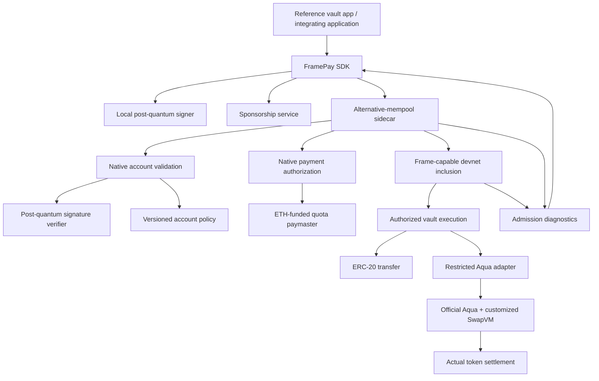

# FramePay SDK — implementation plan and build record

This document records how we intend to build the project, why we choose each component, the work remaining, and what has actually been completed. The product overview is in [README.md](README.md).

## Current status

**Design stage.** Contracts, SDK packages, deployment scripts, and the reference app have not been implemented. Architecture, APIs, and directory layouts below are proposals until verified against the target tooling. Implementation tasks remain unchecked.

## Build record

### November 6, 2026 — project definition and planning

**Completed:**

- Reviewed the saved ETHGlobal prize-page text for the 1inch Aqua and EF alternative-mempool requirements.
- Defined the project as a TypeScript SDK plus a reference DeFi app using a user's smart-account vault.
- Selected the initial scope: PQ authorization, application-funded gas sponsorship, ERC-20 transfers, and one custom Aqua/SwapVM position.
- Documented the proposed architecture, SDK interface, development milestones, validation cases, and demo flow.
- Separated the project description into `README.md` and the implementation plan/build record into `plan.md`.

**Decisions and rationale:**

| Decision | Reason |
| --- | --- |
| SDK plus a reference app | Give developers a reusable integration and demonstrate that it works end to end |
| App-funded sponsorship first | Prove a zero-ETH user flow before adding token-fee settlement complexity |
| ML-DSA as the initial signature candidate | Evaluate a standardized PQ signature scheme; final implementation and parameters depend on measured compatibility and cost |
| One recurring Aqua position | Provide meaningful SwapVM strategy logic and actual settlement for the 1inch integration |
| EF frame-capable environment | Exercise native account/payment authorization and real alternative-mempool submission |
| Defer sealed execution and decentralized decryption | Keep the first implementation focused while preserving them as follow-up work |

**Verification performed:** Documentation structure and source references were checked. No contracts, cryptographic verifiers, SDK code, deployment, or live transaction flow have been tested yet. Linked implementation documentation was unreachable during planning because network DNS resolution failed.

### Recording implementation as it happens

Append a dated entry for each completed milestone. Include:

- What was implemented and which files or commits contain it.
- The selected dependencies, versions, network, and configuration relevant to reproduction.
- Why the approach was chosen and any change from this plan.
- Checks actually run, their outcomes, and links to traces, measurements, or transaction records.
- Remaining limitations and the next step.

Mark tasks complete only when their acceptance evidence exists. This record should describe the actual implementation as it develops, rather than presenting planned features as already built.

## Commit workflow

When the user uses a parenthesized tag as a work or commit instruction, complete the relevant work, perform appropriate verification, and create a local commit. A standalone tag applies to the relevant pending work from the conversation. Mentions of tags as examples or questions do not themselves request a commit. Normalize capitalization and surrounding whitespace.

| User tag | Commit type | Purpose |
| --- | --- | --- |
| `(doc)` or `(docs)` | `docs` | Documentation |
| `(feat)` | `feat` | A new capability |
| `(bug-fix)` or `(fix)` | `fix` | Correcting a defect |
| `(refactor)` | `refactor` | Restructuring without an intended behavior change |
| `(test)` | `test` | Tests and test fixtures |
| `(chore)` | `chore` | Repository maintenance |
| `(build)` | `build` | Build tooling and dependencies |
| `(ci)` | `ci` | Continuous integration |
| `(perf)` | `perf` | A measured performance improvement |

Use Conventional Commit subjects: `type(scope): concrete summary`. Choose a meaningful scope such as `sdk`, `account`, `paymaster`, `aqua`, or `plan`; omit it when it adds no information. Mark breaking changes explicitly when applicable.

Include a concise, factual audit trail in the message body:

```text
type(scope): concrete summary

Why:
- Problem or reason for the change.

Changes:
- What this commit implements.

Validation:
- Checks actually performed and their outcomes.
- Checks not run and the reason, where relevant.
```

Before committing, inspect the working tree and staged diff. Stage only the files or hunks relevant to the requested work; preserve unrelated edits and existing staged work. Split independent changes into coherent commits when needed. Update this plan's build record for meaningful implementation milestones, with actual evidence rather than claims of unperformed checks.

Create new commits rather than rewriting existing history unless the user requests otherwise. Do not create empty commits or fabricate test results. Commit creation does not authorize a push; push only when requested. After committing, report the commit hash, subject, verification outcome, and any relevant work left uncommitted. If a tool restriction prevents the commit, report it explicitly rather than claiming success.

## MVP scope

| Component | First version | Evidence of completion |
| --- | --- | --- |
| PQ vault | Native account validation using one selected post-quantum signature scheme | Valid authorization succeeds; modified signatures, actions, and replay fail |
| Sponsored transfer | Transfer one supported standard ERC-20 from a zero-ETH vault | Real recipient balance change and frame transaction record |
| Paymaster | App-funded sponsorship with application restrictions, expiry, quotas, and gas caps | Authorized request succeeds; unauthorized or exhausted request fails |
| Aqua integration | One real custom SwapVM position using official Aqua contracts | Successful token settlement plus enforced strategy limits |
| Atomic application actions | A supported group of actions with all-or-nothing application state changes | Deliberate failure proves the intended rollback boundary |
| SDK | Prepare, authorize, simulate, submit, and observe operations | Reference app uses the public SDK interface rather than custom submission code |
| Diagnostics | Distinguish authorization, sponsorship, admission, and execution outcomes | A developer can identify and reproduce a failed action |

Start with one chain, one token pair, one account type, and one sponsor. Use standard test tokens and funded test counterparties.

## Architecture



This diagram assigns responsibilities. It is not an exact frame layout or a claim that each validation step uses a separate frame. Use the supplied client's actual EIP-8141 transaction format, authorization rules, and failure semantics.

### Account and authorization

- Store or bind the owner's PQ public key using a representation supported by the chosen verifier.
- Authorize the complete intended operation, including chain/account domain, action data, replay protection, key/policy version, and bounded payment parameters as applicable to the actual frame format.
- Use the target client's canonical signing and encoding rules. Do not invent a transaction digest that omits security-relevant fields.
- Require equivalent authorization for key rotation and other security-critical account changes.
- Do not introduce an unrestricted ECDSA owner, recovery key, or upgrade administrator that bypasses PQ asset authorization.
- Constrain approvals and strategy permissions. An outstanding allowance can permit asset movements without a fresh vault signature, so it is part of the account's effective authority.

For the MVP, prefer a fixed account implementation and a minimal authorization surface. Recovery and upgradeability require a separate design before being offered as features.

### Post-quantum cryptography

**Initial candidate: ML-DSA.** Choose the parameter set only after measuring verification gas, calldata size, account setup cost, and support in the supplied environment.

Use an existing, independently reviewed implementation where available, and verify its provenance and compatibility. This project should integrate a signature scheme, not invent one. Validate the implementation with the scheme's known-answer vectors and malformed-input cases.

The first technical gate is an actual successful PQ verification in the frame-capable client. No PQ precompile or acceptable verification cost is assumed. If that gate fails, the PQ feature remains incomplete; do not substitute an ordinary signature and label it post-quantum.

The claim is limited to the implemented account authorization path. It does not make Ethereum consensus, counterparties, or every external contract quantum secure.

**PQ signatures do not encrypt transactions.** ML-KEM and sealed order flow are separate, deferred features.

### Paymaster

The MVP uses **application-funded gas sponsorship**. It does not charge a token fee to the user.

Public sponsorship parameters should bind the account, authorized operation, chain, expiry, and maximum gas exposure. The paymaster checks supported applications and external quota/policy state through the target client's supported validation mechanism.

Keep these separate:

- ETH held to pay network gas.
- Per-account or per-application sponsorship budgets.
- Any stake required for alternative-mempool admission.
- The user's trading balance.

Two pending operations may both appear eligible against the same old quota. Use appropriate reservations and authoritative accounting, and verify the actual client semantics. Prove the sponsor's exposure when application execution reverts; do not rely on application state that rolls back to preserve a fee reservation.

### Atomic execution

For this project, “atomic” means a documented group of **same-chain application actions** either completes or has its application state changes reverted. It does not mean cross-chain atomic settlement.

Implement the operation through a supported account/adapter execution path with a proven rollback boundary. Do not assume all frames automatically share one revert scope. Gas and native authorization/payment bookkeeping can behave differently from application state on failure.

## Reference Aqua application

Build a **recurring, partially fillable buy position** rather than a generic swap button.

Example: a vault offers up to 10 test-USDC per period to acquire a target asset, subject to a maximum purchase price, overall spending cap, and expiry. State explicitly whether unused period capacity carries over; the initial policy is no carryover.

The position uses:

- **Official Aqua contracts** for the supported liquidity and settlement path.
- **SwapVM strategy logic** for time, price, fill, and capacity restrictions.
- **A custom instruction or supported extension**, where needed, for the position's additional accounting. Its interface depends on inspection of the actual interpreter.
- **A restricted adapter** for SDK-driven vault interactions, if the official execution flow requires one.

The vault is the maker offering funds under its strategy. A funded taker supplies the desired asset and receives the offered asset. Publishing a recurring position does not guarantee it will be filled on schedule; the demo uses explicit test counterparties.

PQ-authorized frame operations create or manage the position using the actual supported contract flow. Taker fills must satisfy the position's enforced permissions and limits. Do not imply that every fill requires a fresh owner signature if the owner has already authorized a standing position.

Settlement must prevent two concurrent fills from exceeding the same remaining capacity. Enforce limits in the mandatory settlement path, not only in frontend checks, SDK simulation, or one optional caller's account validation.

## Proposed SDK interface

The following is design pseudocode. The package is not published, and these methods do not exist yet.

```ts
const vault = createVaultClient({
  chain: frameDevnet,
  account: vaultAccount,
  signer: pqSigner,
  transport: sidecarTransport,
  paymaster: appSponsor,
});

const transfer = await vault.prepareTransfer({
  token: supportedToken,
  recipient,
  amount,
  sponsorship: { maxGasCost },
});

const preview = await vault.simulate(transfer);
const authorized = await vault.authorize(transfer);
const submission = await vault.submit(authorized);
const result = await vault.waitForResult(submission);

const positionAction = await aquaAdapter.preparePosition({
  inputToken,
  outputToken,
  amountPerPeriod,
  periodSeconds,
  maxInputPerOutput,
  totalInputCap,
  expiry,
});

// The SDK also supports preparing and authorizing an adapter action.
const operation = await vault.prepareExecution({
  actions: [positionAction],
  sponsorship: { maxGasCost },
});
```

Expose a signer interface so applications can manage signing independently of transport and sponsorship. Private keys must not be sent to the paymaster service or sidecar.

Simulation is a preview against a particular state, not a promise of inclusion or success. A returned submission identifier is not a receipt. Expose separate submitted, admitted, included, and execution-result states when the underlying infrastructure makes them observable.

Before implementing the API, determine which simulations require a final signature or sponsorship authorization. Do not fabricate an unsigned simulation path if the target client does not provide one.

## Proposed repository layout

```text
apps/
  vault-demo/                 # Reference browser app
packages/
  sdk/                        # Operation lifecycle, transport, diagnostics
  signer-pq/                  # PQ signer adapter and key handling
  adapter-aqua/               # Aqua/SwapVM integration
contracts/
  account/                    # Frame-capable PQ account
  paymaster/                  # Bounded app sponsorship
  aqua/                       # Custom strategy and required adapter
scripts/                      # Deployment and reproducible demo scripts
tests/                        # Cryptographic vectors and integration cases
```

Proposed stack: TypeScript for the SDK, React for the demo, Solidity with Foundry for contracts where supported, and the EF workshop client/sidecar for frame execution. Reuse the workshop's supported tooling and pin versions after inspection.

These directories and commands have not been scaffolded. Runnable installation and development instructions will be added with the first implementation milestone.

## Build order

### Milestone 1 — Prove the execution environment

- [ ] Inspect and pin the EF workshop, client, and sidecar versions.
- [ ] Record RPC endpoints, chain ID, funding instructions, and transaction encoding.
- [ ] Submit one real frame transaction and capture admission/inclusion evidence.
- [ ] Execute one official Aqua/SwapVM position with real token movements.
- [ ] Establish whether both can run in the same frame-capable environment.

### Milestone 2 — Prove PQ account authorization

- [ ] Select an implementation and parameter set based on measurements.
- [ ] Pass cryptographic vectors and invalid/malformed signature cases.
- [ ] Validate a real PQ-authorized account operation.
- [ ] Record verification gas, signature/calldata size, and setup cost.
- [ ] Demonstrate actual baseline-policy rejection versus alternative-policy admission where applicable.

### Milestone 3 — Sponsored transfers

- [ ] Implement bounded application-funded sponsorship.
- [ ] Transfer the supported token from a vault holding zero ETH.
- [ ] Test replay, altered recipient, expired authorization, exhausted quota, and reverting execution.
- [ ] Document account deployment/funding separately; prove sponsored deployment before claiming a gasless first-use flow.

### Milestone 4 — Aqua strategy and SDK

- [ ] Implement the recurring position and mandatory capacity checks.
- [ ] Demonstrate partial fills, period boundaries, expiry, and racing fills.
- [ ] Verify the rollback boundary of supported grouped application actions.
- [ ] Expose operation preparation, signing, submission, and observable status through the SDK.
- [ ] Make the reference app use the SDK end to end.

### Milestone 5 — Submission-ready demo

- [ ] Show zero-ETH sponsored transfer and actual Aqua settlement.
- [ ] Show a tampered PQ authorization rejected.
- [ ] Show a strategy-limit violation rejected.
- [ ] Show who pays gas after an intentionally reverting action.
- [ ] Include reproducible scripts, contract addresses, version information, and explorer evidence.
- [ ] Maintain real development commits throughout the build.

## Demo story

1. Open a prepared vault funded with test tokens and no ETH.
2. Sign and submit a sponsored token transfer with its PQ key.
3. Open the frame transaction and show its actual result.
4. Create or manage the recurring Aqua position through the SDK.
5. Execute a partial fill using a funded test taker and show both token balance changes.
6. Attempt an oversized fill and a tampered authorization; explain their different failure stages.
7. Show the small integration surface used by the demo app.

Label setup steps and seeded test liquidity explicitly. The demo must not imply that the paymaster supplies trading capital or that an already-deployed account proves sponsored deployment.

## Positioning against ERC-4337

ERC-4337 already supports sponsorship and account batching. The project's distinction is a usable SDK for the proposed **native EIP-8141 authorization/payment model**, including a working PQ account and Aqua integration.

Do not claim universal superiority or lower gas without a fair benchmark of equivalent operations. Frame support is currently tied to compatible environments; this repository does not establish mainnet availability or inclusion in a particular Ethereum upgrade.

## Follow-up features

- **ERC-20 gas reimbursement:** action-bound token-fee quotes and settlement proven safe under execution failure.
- **Anon-RPC:** route supported read traffic through Anon-RPC by default once devnet/network compatibility is established. This protects read privacy, not pending swap contents.
- **SealedSwapVM:** encrypted swap instructions, commitment enforcement, a chosen decryption trust model, and confidential settlement delivery. Public commit–reveal alone does not hide an order until execution.
- **PQ encryption:** evaluate ML-KEM-based key establishment separately from ML-DSA signing. Standard ML-KEM is not a ready-made threshold-decryption protocol.
- **Recovery and key rotation UX:** preserve the intended authorization security without introducing a weaker bypass.

The first release demonstrates PQ authorization and sponsored execution. It must not be marketed as providing encrypted pending transactions until the sealed-execution path is implemented and verified.

## Hackathon fit

Requirements below were extracted from the ETHGlobal prize-page snapshot supplied during planning. The snapshot is not currently in the repository; the official prize-page links are listed in Resources.

**Ethereum Foundation — Frame Transaction Alternative Mempool:** the track explicitly welcomes SDKs, high-budget validation, and flexible state access in account/paymaster validation. Supply an admitted devnet transaction link or submission code, and explain the actual design and trade-offs. Aim for complete inclusion and execution evidence as well.

**1inch — Build an Aqua App:** implement a sophisticated Aqua position; SwapVM usage is scored higher. Use official Aqua/SwapVM contracts, demonstrate on-chain token transfers, and preserve meaningful Git history. The page explicitly allows local forks and modified SwapVM redeployments.

A normal local fork does not automatically support EIP-8141. Prefer one working environment for the integration; if different environments are necessary, document the boundary accurately. The supplied rules do not explicitly resolve evaluation of split deployments.

The page states one EF prize per project. Optional Anon-RPC integration does not imply a second EF award.

## Resources

| Resource | Link |
| --- | --- |
| EF workshop quickstart | https://github.com/forshtat/mempool-workshop |
| Alternative-mempool sidecar | https://github.com/forshtat/mempool-workshop-sidecar |
| Frame tracer client | https://github.com/forshtat/ethrex/tree/eip8141-tracer |
| Devnet setup and funding | https://docs.altmempool.wtf/guides/devnet/ |
| Alternative-mempool documentation | https://docs.altmempool.wtf/ |
| Devnet explorer | https://explorer.altmempool.wtf/ |
| EIP-8141 | https://eips.ethereum.org/EIPS/eip-8141 |
| Aqua contracts | https://github.com/1inch/aqua |
| SwapVM contracts | https://github.com/1inch/swap-vm/tree/main |
| Aqua TypeScript SDK | https://github.com/1inch/sdks/tree/master/typescript/aqua |
| Anon-RPC wallet integration | https://ethereum.github.io/anon-rpc/wallets/ |
| EF prize requirements | https://ethglobal.com/events/mumbai/prizes/ethereum-foundation |
| 1inch prize requirements | https://ethglobal.com/events/mumbai/prizes/1inch |

Linked implementation repositories must be inspected before treating any proposed API, verifier, deployment, or frame layout as supported.
